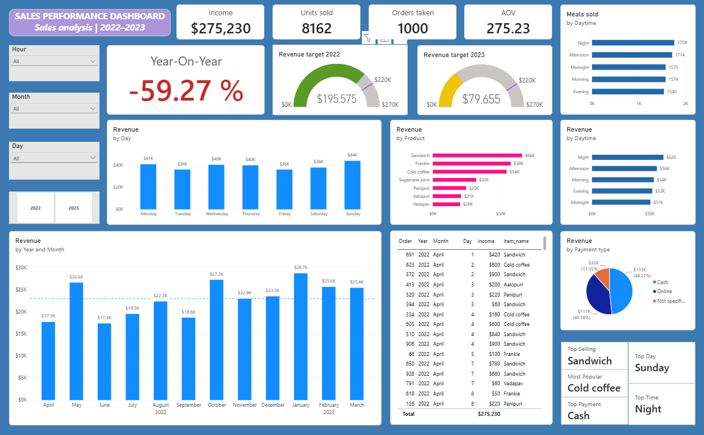
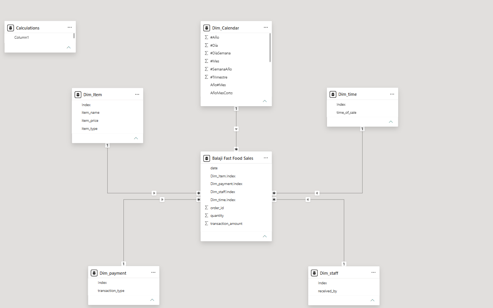

# Data Analysis Portfolio
Portfolio of Data Analytics, Business Intelligence and Data Visualization projects.

## Project overview
An interactive Power BI report exploring 1,000 fast-food sales transactions from April 1, 2022 to March 30, 2023. The dashboard examines revenue, order volume, units sold, product performance, payment methods and demand by day and time of sale.

## Interactive report
Published through Power BI Service
URL: 

## Business questions
1. How much revenue was generated and how many orders and units were recorded?
2. Which products contribute most to revenue, and which sell the most units?
3. Which days and time periods show the strongest sales activity?
4. How are recorded payments distributed across payment methods?
5. How does revenue compare between calendar years 2022 and 2023 within the dataset period?

## Tools
- Microsoft Power BI (Sales_Performance_Dashboard_II.pbix)
- Power Query
- DAX
- CSV data source (Balaji Fast Food Sales.csv)

## Dataset
- **Name:** Balaji Fast Food Sales
- **Source:** [Kaggle – Balaji Fast Food Sales](https://www.kaggle.com/datasets/ahmedhalimo/balaji-fast-food-sales)
- **File:** `Balaji Fast Food Sales.csv`
- **Size:** 1,000 rows × 10 columns
- **Period after parsing:** April 1, 2022 – March 30, 2023

## Files
- `Sales_Performance_Dashboard_II.pbix` — Power BI report.
- `Balaji Fast Food Sales.csv` — source dataset used in the report.
- `Sales_Performance-Dashboard_II.png` — dashboard preview.

## Data quality
- `transaction_type` contains 107 missing values (10.7% of rows). These were change to "not specified" while these unknown values were not possible to fill
- Dates are represented with mixed separators (`-` and `/`). They parse consistently as month-first dates (`MM-DD-YYYY` or `MM/DD/YYYY`) to produce the dataset period April 2022–March 2023.
- `transaction_amount` equals `item_price × quantity` for all 1000 rows.
- No exact duplicate rows were found.
- `order_id` has 1000 distinct values.

## Dashboard preview

## Data Model preview

## Data Modelling
After checking data distribution and variables a data star model was the way to work with
There are 5 dimension tables which corresponds to:
- Item: contains item name, price, type of food
- Staff: contains gender type
- Time of the day: contains list of day stages like 'morning','afternoon','evening', etc
- Payment type: contains cash or online payment, includes some missing values replaced as 'not specified' 
- Calendar: contains business exercise period of sales considering days, months and years (done for days/dates with no sales)

## Key performance indicators
| KPI | Value |
|---|---:|
| Revenue | $275,230 |
| Units sold | 8,162 |
| Orders | 1,000 |
| Average order value | $275.23 |
| Revenue 2022 | $195,575 |
| Revenue 2023 | $79,655 |
| Year-on-year change displayed | -59.27% |

**Interpretation note:** 2022 and 2023 are partial calendar years in this dataset. The -59.27% calculation compares the revenue recorded in 2023 (January–March) with the revenue recorded in 2022 (April–December), so it should be seen as a KPI build for checking performance until the last period of exercise while recording sales for the next months of the same year.

## Findings from dashboard
- **Top revenue product:** 'Sandwich'
- **Top unit-volume product:** 'Cold coffee'
- **Highest-revenue month:** 'January'
- **Highest-revenue time period:** 'Night'
- **Revenue by payment type:** 'Cash'
- **Highest-revenue day:** 'Sunday'

## Measures
Calculations done in PowerBI using DAX:
- Total Revenue
- Units Sold
- Total Orders
- Average Order Value
- Revenue Variance %

## Tools used
- MAXX
- TOPN
- SUMMARIZE
- CALCULATE
- SUM
- SAMEPERIODLASTYEAR
- SUM
- DIVIDE
- COUNT

